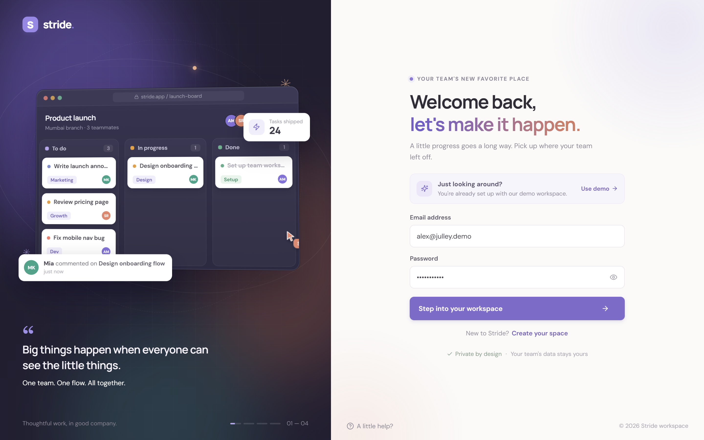
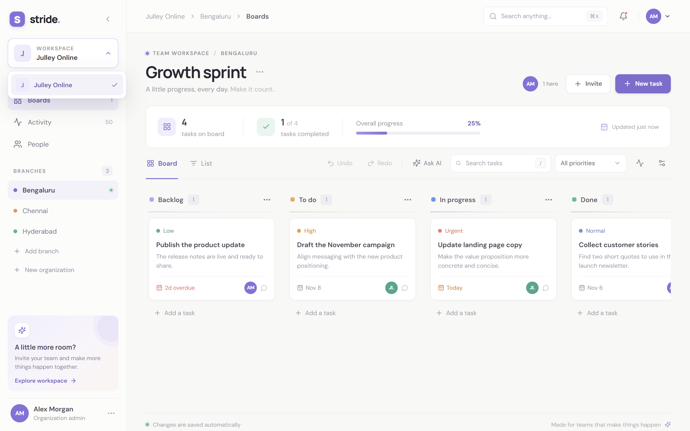
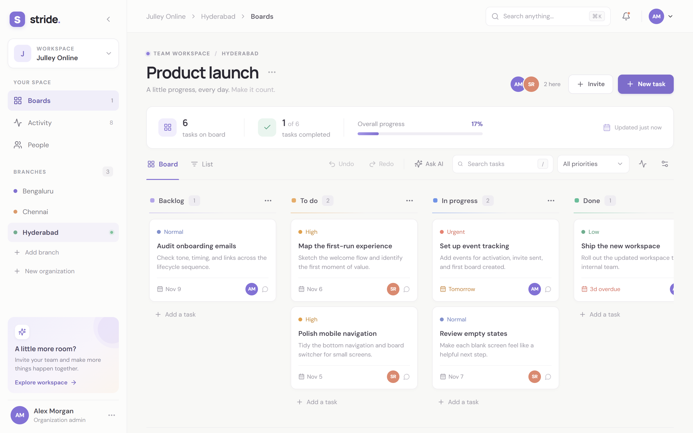
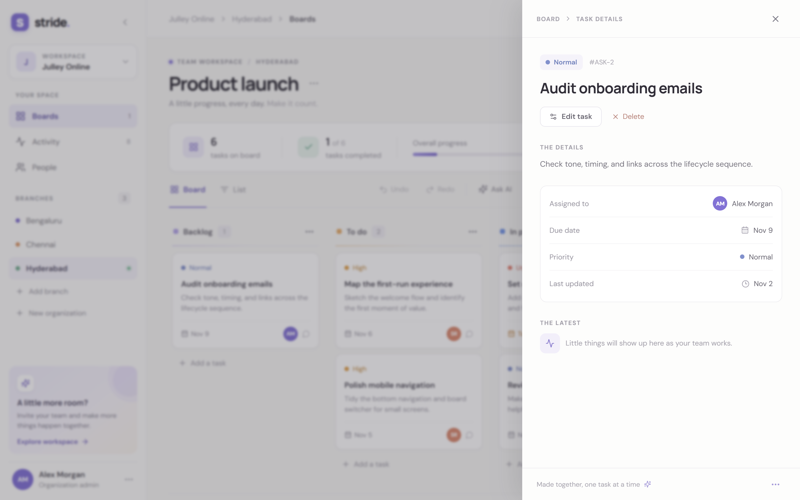
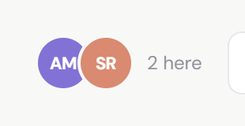
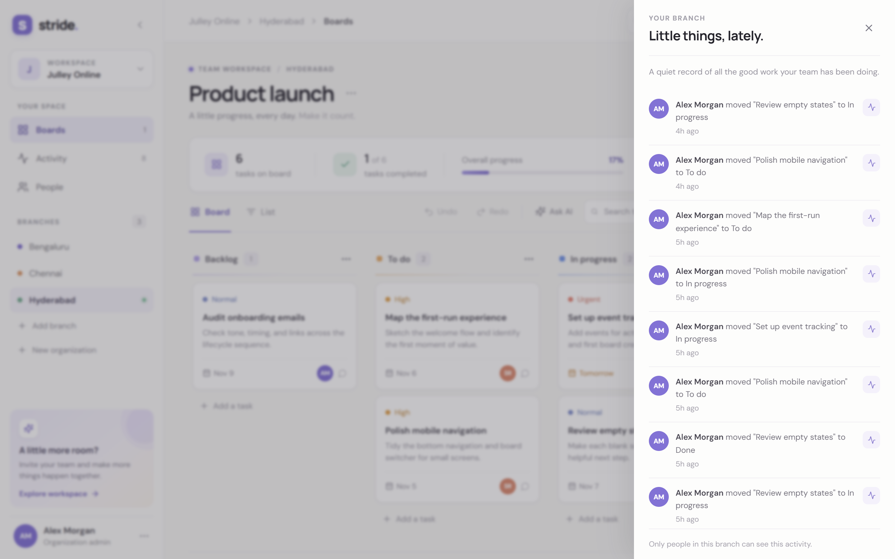
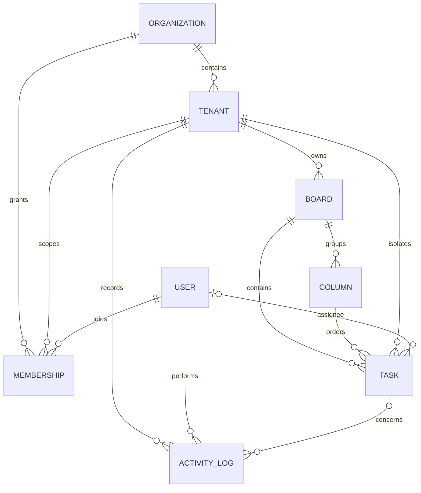

# Stride — a calmer team board

A real-time collaborative Kanban app for organizations with independently scoped branches. Each branch has its own boards, tasks, membership, activity, and live presence.

## Screenshots

A quick look at the main screens.

**Signing in**



**Picking your organization and branch**



**The board**



**Task details**



**Who's here right now**



**Recent activity**



## What’s here

- React + Vite workspace UI with branch switching, task search/filtering, drag-and-drop, task details, activity history, presence, and undo/redo for moves.
- Express REST API with JWT authentication, bcrypt password hashing, input validation, and role-based permissions.
- PostgreSQL data model managed by Prisma. Board, column, task, and activity queries are scoped to a verified tenant.
- Socket.IO rooms are joined only after the server verifies the caller’s membership; board and activity changes are broadcast only to that tenant.
- Optimistic card movement/editing with server-side version checks and a serializable reorder transaction.
- A seed script that creates two separate branches, sample work, and demo teammates.

## Run locally

Requirements: Node.js 20.19+ (or 22.12+), Python 3.11+, and a PostgreSQL database. Docker is not required; use a hosted PostgreSQL service such as Neon, or install PostgreSQL locally.

1. Install packages:

   ```sh
   npm install
   ```

2. Install the Python service packages:

   ```powershell
   python -m venv .venv
   .\.venv\Scripts\Activate.ps1
   python -m pip install -r ai_service\requirements.txt
   ```

   Keep this PowerShell window activated when running the `npm` commands. They launch the assistant using the active `python` environment.

3. Configure PostgreSQL and the service secrets in `.env`. Keep the database settings you already use; copy `.env.example` only if you do not already have a `.env` file. For Neon, copy the pooled connection string into `DATABASE_URL` and the direct (unpooled) connection string into `DIRECT_URL`. Both should include `sslmode=require`. On PowerShell:

   ```powershell
   if (-not (Test-Path .env)) { Copy-Item .env.example .env }
   ```

   Set `AI_SERVICE_URL` to `http://127.0.0.1:8000`. Set `AI_SERVICE_TOKEN` to a new random secret and use the exact same value in the Express and Python processes. For example, generate a value with:

   ```powershell
   python -c "import secrets; print(secrets.token_urlsafe(32))"
   ```

   Add the generated value as `AI_SERVICE_TOKEN="..."` in `.env`. The same `.env` file is loaded by both services. Keep your existing Neon `DATABASE_URL` and `DIRECT_URL` if you use Neon. Set `JWT_SECRET` to a separate long random value; never commit `.env`.

4. With your hosted PostgreSQL database ready (or your local PostgreSQL server running), create the tables and demo workspace:

   ```sh
   npm run db:migrate -- --name init
   npm run db:seed
   ```

5. Start the API, web app, and Python assistant:

   ```sh
   npm run dev
   ```

   Open `http://localhost:5173`. Express listens at `http://localhost:4000`, and FastAPI listens privately at `http://127.0.0.1:8000`. A standalone AI health check is at `/health`.

The assistant is a local, deterministic tool-using service; it does not call an external LLM provider. It summarizes a verified tenant board, checks for overdue/urgent/unassigned work, and prepares task actions for a person to approve. The Express API checks the user's membership before sending board data to FastAPI. Task writes still use the normal authenticated, version-checked API.

Run the agent unit tests with `npm run test:ai`. If PowerShell blocks venv activation, run `Set-ExecutionPolicy -Scope Process -ExecutionPolicy Bypass` in that terminal, activate the environment, and install the requirements again.

To create a production frontend bundle, run `npm run build`. Run `npm start` to start the API server. Configure the production web host to serve `dist/` and proxy `/api` and `/socket.io` to the API, or set `VITE_API_URL` to the API origin at build time. Set `CLIENT_ORIGIN` to the exact public web origin.

## Demo accounts

All demo accounts use `JulleyDemo!`. The existing demo email addresses and password are retained so existing seeded accounts continue to work:

| Email | Access |
| --- | --- |
| `alex@julley.demo` | Organization admin; can switch between both branches |
| `sam@julley.demo` | Member of Hyderabad only |
| `jordan@julley.demo` | Member of Bengaluru only |

Use the Alex account to explore both branches and see how a member scoped to one branch cannot join the other branch’s API or live channel. These credentials are for local evaluation only.

## Tenancy and authorization

The hierarchy is `Organization → Tenant (branch) → Board → Column → Task`. A membership ties a user to an organization and, for branch-scoped roles, to a tenant. The non-null membership `scopeKey` uniquely represents either the organization scope (`ORG`) or the tenant ID, avoiding PostgreSQL's default behavior of treating `NULL` values as distinct in unique constraints. Organization admins have an organization-level membership and can access its branches; tenant admins and members require a membership for the requested tenant. Roles are `ORG_ADMIN`, `TENANT_ADMIN`, and `MEMBER`.

The browser never establishes its own authority by choosing a tenant ID. Every tenant REST request checks the signed-in user’s membership before reading or mutating data. Resource lookups include the verified tenant ID, and database relations tie tasks to a column and board in that same tenant. Socket.IO repeats the membership check when handling `tenant:join`. A tenant ID outside a user’s organization returns a not-found response to avoid confirming that it exists.

Workspace data is shared between members of the same tenant; roles restrict administrative actions rather than individual task visibility. User passwords are hashed with bcrypt. JWTs expire after seven days. Use HTTPS, a managed secret, rate limiting, and a production session/revocation strategy before deployment.


## Data model

`prisma/schema.prisma` is the canonical schema. Key invariants are captured with composite relations: a task's `(columnId, boardId, tenantId)` must reference a column on that board and tenant, and a column's `(boardId, tenantId)` must reference a board in that tenant.



## API and realtime reference

See [docs/API.md](./docs/API.md) for request examples, tenant-scoped endpoints, role requirements, concurrency behavior, and Socket.IO event shapes.

## Project layout

```text
ai_service/
  requirements.txt    FastAPI service dependencies
  app/
    main.py           FastAPI endpoints and internal service auth
    agent.py          Pydantic models, analysis tools and action planner
  tests/
    test_agent.py     Analytics, action and validation tests
prisma/
  schema.prisma       PostgreSQL models and tenant constraints
  seed.js             Repeatable two-branch sample workspace
server/
  index.js            Express API, auth, RBAC, Socket.IO and presence
  transaction.js      Bounded retry for PostgreSQL serialization conflicts
  transaction.test.js Tests for transaction conflict classification and retries
src/
  main.jsx            React app and Kanban interactions
  styles.css          Responsive visual system
docs/
  API.md              REST and realtime protocol
```

## Trade-offs and next steps

- For the assignment demo, JWTs are held in browser local storage and API instances use in-memory presence. Move to secure, httpOnly cookies and shared infrastructure for a public deployment.
- Membership invitations, email verification, password recovery, pagination, rate limiting, and org/branch deletion flows are intentionally out of scope.
- The app stores an activity record for task actions; it does not retain full before/after snapshots. Undo is not an audit restore.
- The AI service uses a small deterministic intent planner and local tools rather than a hosted language model. This keeps board data private and works without a model key; a future model integration should keep tool permissions and human confirmation in this service boundary.
- Run `npm run test:api` to test API transaction retry behavior, and `npm run test:ai` to run the Python agent tests.
- Run `npm run db:generate` after changing the Prisma schema. `npm run db:migrate -- --name <change>` creates a local migration.
